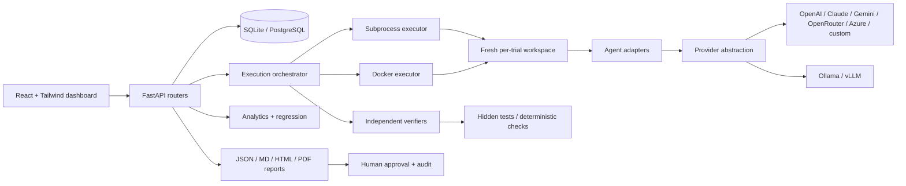

# Architecture

## Data flow

1. Benchmarks are loaded from immutable on-disk packages and hashed.
2. Experiments create queued trials for every agent × benchmark × repetition.
3. The executor copies a fresh workspace, runs the agent, then runs an independent verifier.
4. Trajectories, evidence, metrics and artifacts are persisted.
5. Analytics compares matched cells and detects regressions.
6. Reports combine evidence and policy gates; approval is a separate auditable action.