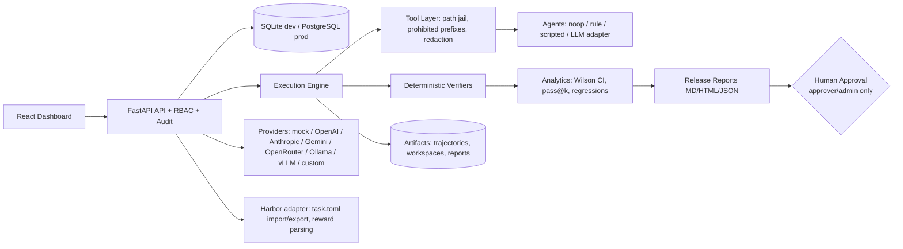

# Architecture

Package layout is a single Python package (`backend/app`) with separated modules
(config, database, models, security, benchmarks, tools, agents, providers, verifiers,
execution, classification, analytics, reports, harbor_adapter, sandbox) — the top-level
`agents/ providers/ evaluation/ sandbox/ analytics/ worker/ reports/` folders document the
extension points without duplicating implementations.

## Data flow (primary journey)
Create/select task → configure agents/providers → create experiment (trials queued) →
run (fresh workspace per trial, tool-layer trajectory) → independent verifier →
failure classification → analytics (success rate, CI, pass@k, latency, failures) →
comparison/regression vs baseline → release report + gate → human approve/reject (audited).

## Execution states
queued → preparing/copying workspace → running → verifying → completed | failed | timed_out | cancelled.
Infrastructure/provider failures are classified separately and never silently counted as agent incompetence.
